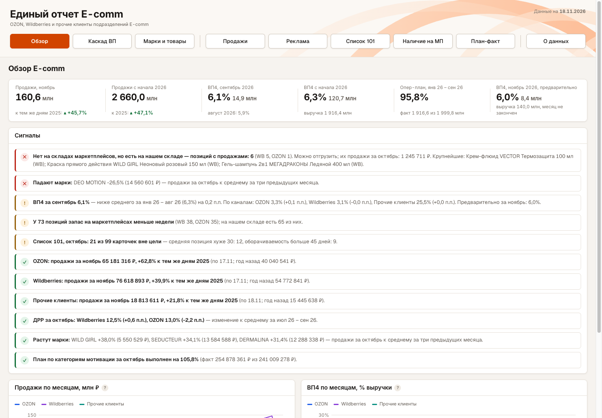
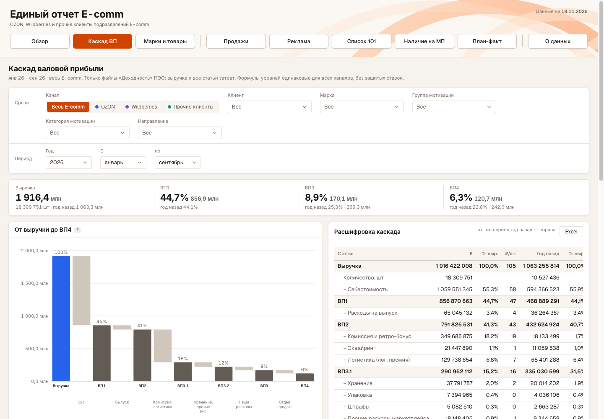
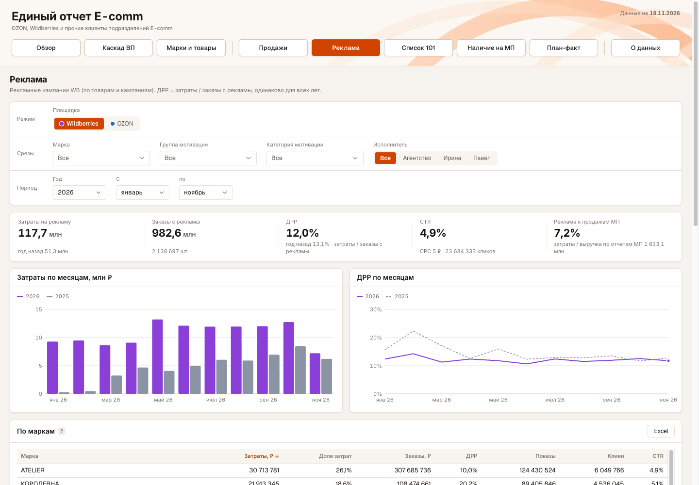
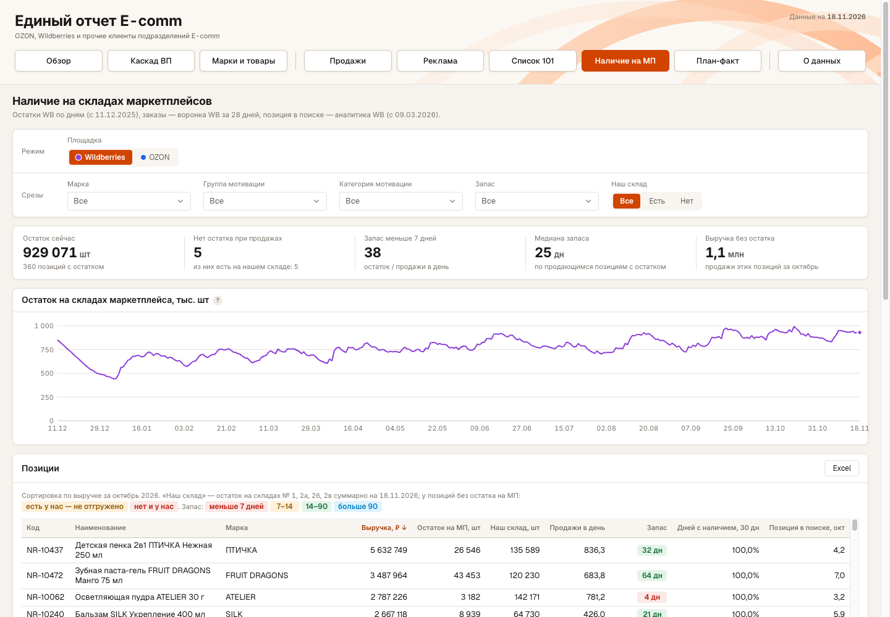

# Marketplace Profitability Dashboard

[](https://github.com/MaxWell-com/marketplace-profitability-dashboard/actions/workflows/ci.yml)


**One E-comm report for a manufacturer selling through Wildberries, Ozon and online retailers.** It covers profitability down to the fourth level of gross profit, sales, advertising, marketplace stock, the managed list of top cards and plan vs actual. It reconciles four kinds of sources:
- 1C sales;
- marketplace reports;
- the finance department's monthly profitability files;
- marketplace APIs.

For the months the finance files do not cover yet, it fills the gap with a **back-tested estimate**.

> This is a production project, adapted for public release. In production it replaced a Power BI report for the E-comm team of a consumer-goods manufacturer. It pulled an OLAP cube (SSAS Tabular, DAX over HTTP-XMLA), an MS SQL DWH with marketplace API data and the finance department's Excel files. The public version ships with a deterministic **demo data source** that produces the same inputs, so it runs with zero infrastructure: `npm start`. The manufacturer (NORD), its brands, products, people and most clients are fictional. Wildberries and Ozon appear under their real names, but **every number is synthetic**. The UI is in Russian, as in production.

<p align="center"></p>

## Pages

| Page | What the user gets |
|---|---|
| **Обзор** (overview) | Month-to-date and year-to-date sales against the same days last year, ВП4 margin, plan attainment, and **up to 12 automatic signals**. Signals cover: items out of stock on marketplaces but in our warehouse, ad cost ratio drift, list-101 cards off target, falling or rising brands, low cover, and plan lag by category |
| **Каскад ВП** (gross-profit cascade) | Revenue → ВП1 (cost of goods) → ВП2 (production) → ВП3.1 (commission, acquiring, logistics) → ВП3.2 (storage, packaging, fines) → ВП3 (royalties, trade marketing, listing…) → ВП4 (sales department). Waterfall chart and a line-by-line breakdown against last year, sliced by channel, client, brand and motivation group |
| **Марки и товары** (brands and products) | The cascade by brand and by SKU, with growth against last year |
| **Продажи** (sales) | 1C sales and marketplace reports with and without VAT, by day and month. Marketplace charges by article and seller cabinet, with the share linked to products |
| **Реклама** (advertising) | WB and Ozon campaigns: spend, ad-attributed orders, ad cost ratio (ДРР), CTR, CPC, by month, brand, campaign and performer |
| **Список 101** | The 101 WB cards the team manages by hand: revenue, ad spend and ДРР, average stock, search position against a target of 30, turnover against 45 days, and list changes |
| **Наличие на МП** (marketplace stock) | Daily WB and Ozon stock, sales per day, days of cover by bucket (< 7, 7–14, 14–90, > 90), days in stock, search position and our own warehouse stock, so "ship it, we have it" is one click away |
| **План-факт** | Operating plan by client and manager, and plan by motivation category, against 1C actuals |
| **О данных** (about the data) | Data horizon of every source, the file column → cascade line mapping, and **the accuracy of the estimate on closed months** |

Every table exports to Excel in the browser. `npm run standalone` produces a single self-contained HTML file with the data embedded, which works offline.

<p align="center"></p>

## Engineering decisions

* **The finance files are the source of truth, and the gap is estimated.** The profitability files close a month or two late. For the open months the report builds an estimate:
  - revenue, units and cost come from 1C;
  - Ozon/WB charges come from the marketplace reports, without VAT;
  - every other line is the client's average share of revenue this year.
  
  As soon as a month appears in the file, the estimate is replaced automatically. Its accuracy is back-tested on every closed month and shown on «О данных».
* **One snapshot, built by the server.** The server pulls the cube, the DWH and the files in parallel, with at most three concurrent cube queries. It builds JSON for every page, gzips it once and serves it from memory. A stale snapshot keeps being served while a new one builds in the background, so users never wait. Parsed Excel files are cached by size and modification time.
* **Marketplace SKUs are bridged to 1C codes through sales.** A WB card (nm_id) or an Ozon SKU gets its 1C code from the marketplace financial report rows that reference both. Stock, orders, the funnel, search positions and list 101 then join on that code.
* **Accounting changes are handled, not hidden.** Before 2026 WB/Ozon revenue in 1C was net of commission, and VAT changed from 20% to 22% in 2026. Year-over-year comparisons divide by the right rate and flag the commission change.
* **A streaming xlsx reader with no dependencies.** The profitability files are large. They are read row by row straight from the zip stream, mapped to cascade lines by column name, and unknown columns are reported as warnings instead of being silently dropped.
* **Fail safely on runaway queries.** The cube client caps the response size, so a query that accidentally multiplies tables fails the build with a clear message instead of crashing the process.
* **Monitoring endpoints.** `/api/ops/etl` and `/api/ops/signals` (bearer token) report build status, snapshot age, partially read sources and a profitability file that lags behind.
* **One data-source seam.** `DATA_SOURCE=demo|olap` swaps only the inputs of `build()` (`src/dataSource.js`). Cascade, estimate, joins and every page run the same code in both modes.

<p align="center"></p>

## Demo data

`src/demo/model.js` simulates two and a half years of a growing E-comm business: eight partners and about 500 products. Wildberries and Ozon are the largest partners; the others are smaller marketplaces, online retailers and a professional web store. Everything is derived from one monthly sales book, so the sources reconcile:
- 1C sales, daily with weekday and 11.11 / Black Friday peaks;
- marketplace reports and charges by article and cabinet;
- the profitability files with cost lines per channel, closed two months back so the estimate has work to do;
- WB and Ozon campaigns, whose name suffix encodes the performer;
- marketplace stock with replenishment and chronic stock-outs, WB orders, search positions and the funnel;
- plans by client and by category, the product references and list 101.

The demo "today" is fixed at `2026-11-18`, because the year selectors and plan pages are built for 2025–2026. `DEMO_TODAY` can move it within 2026.

## Quickstart

```bash
npm ci
npm start                 # http://localhost:3000, demo data (the first snapshot takes ~2 s)
npm test                  # node:test, no infrastructure needed
npm run standalone        # with the server running: dist/ecomm-report.html, a single offline file
```

Docker:

```bash
docker build -t marketplace-profitability-dashboard .
docker run -p 3000:3000 marketplace-profitability-dashboard
```

To use live sources, set `DATA_SOURCE=olap`, the `OLAP_*` and `DWH_*` variables and `PEO_DIR`, the folder with the finance files (see [.env.example](.env.example)). Access can be restricted to SSO groups with `REQUIRED_TEAM` behind an auth proxy that sets `X-Auth-Request-*` headers.

<p align="center"></p>

## Repository structure

```
src/
├── server.js          # entry point: warm-up build, TTL refresh timer
├── app.js             # routes: /, /data/<page>.json, /api/meta, /api/refresh, /api/ops/*, /health
├── dataSource.js      # DATA_SOURCE=demo|olap — the data-source seam
├── sources/
│   ├── demo.js        # synthetic inputs
│   └── olap.js        # live inputs: cube + DWH tables, finance files
├── demo/model.js      # the simulated E-comm business → every input of build()
├── snapshot.js        # inputs → build() → gzipped JSON per page, in memory
├── etl/
│   ├── build.js       # page data: profit, sales, ads, stock, list101, plan, codes, meta
│   ├── cascade.js     # file columns → cost lines → ВП1–ВП4
│   ├── estimate.js    # estimate of months not yet in the files + back-test
│   ├── excel.js       # finance files: profitability, product reference, list 101
│   ├── xlsxReader.js  # streaming xlsx reader, no dependencies
│   ├── sources.js     # runs the queries below into tables
│   └── queries/       # 12 DAX queries (cube) and 9 SQL queries (DWH)
├── olapClient.js      # HTTP-XMLA client: concurrency cap, response-size guard, retries
├── dwhClient.js       # MS SQL client
├── view.js            # placeholder, error and forbidden pages
└── auth.js            # optional identity from X-Auth-Request-* headers
public/                # the single-page dashboard: app.js, charts.js (SVG), xlsx.js, styles, fonts
scripts/standalone.js  # one-file offline export
test/                  # node:test — demo ⇄ ETL contract, server, access control
```

**Stack:** Node.js · Express · vanilla JS + SVG charts · DAX / SSAS Tabular (HTTP-XMLA) · MS SQL · streaming XLSX · Docker · GitHub Actions

---

## Кратко на русском

**Единый отчёт E-comm** для производителя, который продаёт через Wildberries, Ozon и онлайн-ритейл. Вкладки:
- обзор с автоматическими сигналами;
- каскад валовой прибыли ВП1–ВП4;
- марки и товары;
- продажи и начисления маркетплейсов;
- реклама (ДРР, исполнители);
- список 101;
- наличие на складах маркетплейсов;
- план-факт;
- «О данных».

Таблицы выгружаются в Excel, отчёт собирается и в один автономный HTML-файл.

* **В продакшене** сервер сам собирал снимок из OLAP-куба, DWH и файлов «Доходность» финансовой службы. Месяцы, которых ещё нет в файлах, показываются оценкой, а её точность проверяется на закрытых месяцах.
* **Публичная версия** работает на детерминированных демо-данных в формате тех же входов: 1С, отчёты и начисления маркетплейсов, реклама, остатки, планы, файлы доходности. Производитель, бренды, товары, люди и большинство клиентов вымышленные. Wildberries и Ozon названы реально, но все цифры синтетические. Запуск — `npm start`.

## License

[MIT](LICENSE)
